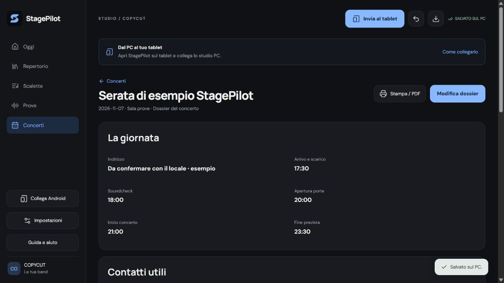
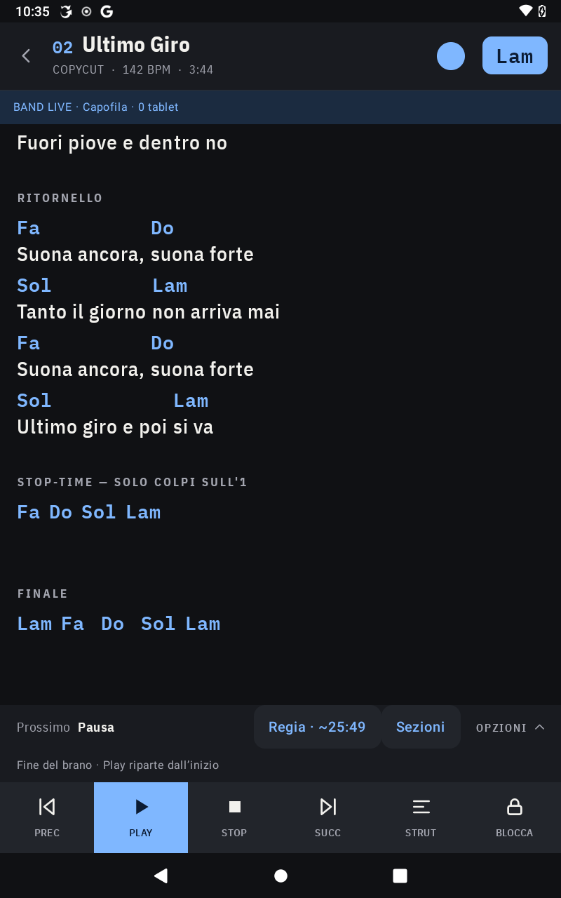
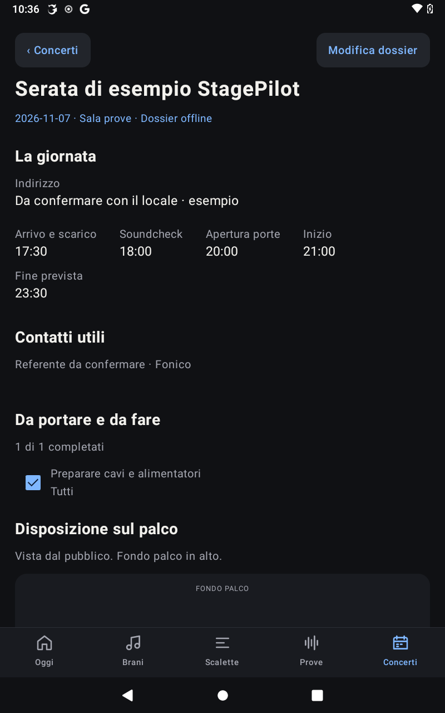

# StagePilot


[](LICENSE) [](https://github.com/RobyPisco/StagePilot/releases/tag/v0.2.0-beta.1) [](https://github.com/RobyPisco/StagePilot/releases/tag/v0.2.0-beta.1)

**Prepara sul PC, prova con un obiettivo, suona dal tablet.** Android nativo e studio web locale, con librerie SQLite autonome e sincronizzazione esplicita. Tema grafite e azzurro, app separata da Backline (`it.stagepilot.app`).

## Funzioni della versione 0.2.0

- **Importazione automatica:** incolla testo e accordi da Ultimate Guitar, oppure apri un file ChordPro/testo. La pulizia legge i metadati già presenti; il riconoscimento confronta le frasi con LRCLIB e propone titolo/artista, durata e BPM della registrazione Deezer. Mostra album, fonti e alternative, senza modificare le parole, gli accordi o le correzioni manuali. Se il catalogo non ha il BPM, lo dichiara e lascia il campo modificabile. Il web conserva la bozza nella scheda del browser anche dopo un ricaricamento. Su Android il riconoscimento online usa lo studio PC collegato nelle impostazioni; importazione e lettura restano disponibili offline.
- **Repertorio:** creazione, modifica, ricerca, tag, BPM, tonalità, durata, note condivise e per ruolo, stato di preparazione e appunto di prova.
- **Scalette:** più scalette per gruppo, duplicazione, riordino, pause e cambi strumento, somma delle durate e condivisione come file o elenco su Android.
- **Prova guidata:** agenda di passaggi specifici, scelta della sezione del brano, obiettivo, ruolo responsabile, decisioni condivise, stato da risolvere/risolto e filtro personale. Apertura del solo passaggio nel lettore, senza modificare il chart originale. Sessioni cronometrate con riepilogo nel registro.
- **Band Live senza PC:** un tablet Android apre la sessione sulla Wi-Fi e gli altri entrano con indirizzo e codice. Condivide scaletta, cambio brano, Play/Pausa/Stop e salto alle sezioni. Ogni musicista mantiene lettura e trasposizione personali, può passare in lettura libera e riaprire l’ultima copia offline. Il capofila mantiene StagePilot aperto; non è sincronizzazione audio.
- **Dossier concerto:** orari di arrivo, soundcheck, porte e fine, indirizzo, contatti, checklist con responsabili, schema del palco e lista ingressi del mixer. Modifica su web e Android, stampa/PDF dal browser, dati offline su tablet.
- **Guida integrata:** Oggi → Guida e aiuto su Android; Guida e aiuto nella barra laterale web. Manuale sorgente in [docs/GUIDA.md](docs/GUIDA.md).
- **Concerti:** data, orario, luogo, scaletta e appunti. Controlli sui brani ancora da preparare, sui passaggi aperti e sulle durate mancanti. Accesso alla prova filtrata per la scaletta della serata.
- **Palco Android:** Play avvia lo scorrimento del testo; l’attesa iniziale del brano mostra un conto alla rovescia e si può saltare con **Parti subito**. Se tutto il brano entra nello schermo viene indicato. Schermo acceso, trasposizione, notazione inglese/italiana, scorrimento, solo testo/struttura, note per ruolo, capotasto, blocco del chart, prossimo brano e metronomo. Regia del set con salto diretto ai brani, tempo rimanente stimato e richiesta fuori scaletta dal repertorio. Supporto ai tasti di girapagine Bluetooth.
- **Dati:** SQLite sul PC e sul tablet, backup JSON compatibili con Backline, copie locali Android, cronologia del PC con annullamento. La sincronizzazione unisce campi indipendenti, chiede una scelta per i conflitti e rifiuta conferme riferite a revisioni superate. Le preferenze personali di lettura non vengono imposte agli altri dispositivi.

## Scarica e inizia

**[Scarica la prima versione gratuita per Windows](https://github.com/RobyPisco/StagePilot/releases/tag/v0.2.0-beta.1)** · [Tutte le versioni di prova](https://github.com/RobyPisco/StagePilot/releases) · [Guida in italiano](docs/GUIDA.md)

Questa prima distribuzione è una **beta**. Nella pagina Releases trovi:

- **StagePilot-Studio-0.2.0-Windows-x64.exe**: studio web completo, con Python incluso. Windows 10/11 a 64 bit, nessuna installazione richiesta. Avvialo: si apre nel browser. Lascia aperta la sua finestra mentre lavori; chiudila per terminare.
- **StagePilot-0.2.0-debug.apk**: app Android di prova, Android 10 o successivo. Installazione manuale e aggiornamenti con la stessa firma; esporta un backup prima di aggiornare.
- **StagePilot-0.2.0-Windows-x64.zip**: EXE, guida offline e avvisi delle dipendenze in un unico archivio.

L’EXE attuale non ha una firma digitale del produttore: Windows potrebbe segnalarlo come applicazione non riconosciuta. Scarica i file solo dalle Releases di questo repository. L’APK è ancora una build debug: non è una pubblicazione sul Play Store.

### Collegare PC e tablet

1. Avvia l’EXE e premi **Collega Android** nello studio.
2. Tablet e PC sulla stessa Wi-Fi: sul tablet apri **Impostazioni → Studio web** e inserisci indirizzo e codice mostrati dal PC.
3. Torna a **Oggi** sul tablet, salva le modifiche sul web e premi **Invia al tablet**. Attendi la conferma finale.

Il primo avvio dell’EXE crea una libreria vuota in `%LOCALAPPDATA%\StagePilot\Studio`: aggiornare o spostare l’EXE non cancella questi dati. Se già usavi lo studio da sorgente, esporta il backup dal vecchio studio e importalo nel nuovo; i due percorsi sono distinti. Non aprire contemporaneamente il vecchio studio e l’EXE sulla stessa porta: verrà riutilizzato quello già aperto.

Band Live usa invece **Oggi → Band Live**: il capofila apre una sessione e gli altri tablet entrano con indirizzo e codice. Per questa modalità il PC non serve.

## Screenshot reali

### Studio web: dossier del concerto



### Android: palco e dossier offline

<p>
  
  
</p>

## Compilare dal sorgente

Servono Node.js 24, Python 3.10+, JDK 21 e Android SDK 36. Lo studio da sorgente continua a funzionare con `StagePilot.cmd`, dopo aver compilato il web.

```powershell
cd web
npm ci
npm test
npm run build
cd ..
python studio/server.py
```

Per compilare l’EXE su Windows x64 con Python 3.12:

```powershell
python -m pip install -r tools/requirements-windows.txt
python tools/build_windows.py
```

Verifica il pacchetto con `python tools/smoke_windows.py`. La guida si rigenera con `python tools/build_guide.py` prima delle build web e Android.

Il risultato è `dist/windows/StagePilot-Studio.exe`. Include solo pagina compilata, runtime Python e codice del server; non include `studio/data`, librerie personali o codici di collegamento.

Per Android:

```powershell
$env:JAVA_HOME = 'C:\Program Files\Android\Android Studio\jbr'
$env:ANDROID_HOME = "$env:LOCALAPPDATA\Android\Sdk"
New-Item -ItemType Directory -Force .tmp | Out-Null
$env:JAVA_TOOL_OPTIONS = "-Djdk.net.unixdomain.tmpdir=$((Resolve-Path .tmp).Path)"
.\gradlew.bat testDebugUnitTest assembleDebug assembleDebugAndroidTest
adb install -r app\build\outputs\apk\debug\app-debug.apk
```

## Dati e recupero

- PC da sorgente: `studio/data/stagepilot.sqlite`; EXE Windows: `%LOCALAPPDATA%\StagePilot\Studio\stagepilot.sqlite`, entrambi esclusi dalla distribuzione; conserva fino a 40 revisioni precedenti.
- Android: `stagepilot.sqlite` nella memoria privata dell'app, con una cronologia locale; **Impostazioni → Backup** esporta/importa il formato JSON.
- La scrittura della libreria e della base di sincronizzazione avviene nella stessa transazione SQLite.
- Per migrare il repertorio di Backline, esporta il suo backup e importalo in StagePilot. Il progetto non modifica i dati dell'altra app.
- Un backup esportato è il modo più semplice per trasferire o conservare l'intera libreria. Disinstallare un'app Android rimuove la sua memoria privata.

## Verifiche

- JVM Android: test del motore musicale, importazione, normalizzazione, pacchetti, scalette e preparazione della serata.
- Web: test del convertitore distribuito, cancellazione con rimozione dei riferimenti, tempi/trasposizione e confronto delle bozze.
- Server: test SQLite, riapertura, annullamento, revisioni, autenticazione LAN, conflitti, passaggi di prova e richieste HTTP. Il riconoscimento ha test su testi non corrispondenti, cover/live, BPM mancanti, fonte della registrazione, cache, rete assente e limiti dei servizi.
- **Fire HD 8 / Android 10:** quattro test strumentati su conversione ICU, transazioni SQLite (incluso errore a metà scrittura), dossier e componenti nativi Band Live con perdita/ripristino della connessione e cache offline. Provati anche importazione dal browser, persistenza dopo ricaricamento, trasferimento USB e Wi-Fi, conflitto con revisione superata e apertura del singolo ritornello sul tablet.

```powershell
cd studio
python -m unittest discover -v
```

Per i test sul dispositivo installare anche `app/build/outputs/apk/androidTest/debug/app-debug-androidTest.apk`, poi:

```powershell
adb shell am instrument -r -w it.stagepilot.app.test/it.stagepilot.app.SmokeInstrumentation
```

## Piano da venerdì a domenica

- **Venerdì sera:** modello dati, progetto Android separato, interfaccia condivisa e SQLite.
- **Sabato mattina:** importazione, repertorio e scalette; sabato pomeriggio lettore da palco e studio web.
- **Sabato sera:** sincronizzazione, backup e test sul dispositivo.
- **Domenica mattina:** prova guidata, preparazione concerti e regia live; domenica pomeriggio prova completa della band, correzioni di leggibilità e confezionamento.

## Confini di questo MVP

La sincronizzazione è avviata esplicitamente da **Invia al tablet** sul web o da **Sincronizza con il PC** sul tablet; riguarda la libreria condivisa. Band Live è invece una sessione autonoma fra tablet per i comandi di palco. Per ricevere le richieste web il tablet deve avere StagePilot aperto e configurato, sulla stessa Wi-Fi del PC. Durante il palco o una modifica la richiesta aspetta il ritorno a Oggi; eventuali conflitti richiedono una scelta sul tablet. Le stime live dipendono dalle durate inserite. Non sono ancora inclusi importazione di spartiti PDF, registrazioni audio, multitraccia, MIDI, account/cloud e ricerca/importazione diretta da URL Ultimate Guitar. Il click audio e i pedali reali richiedono una prova musicale dedicata; i relativi controlli già esistono.

`preview/` conserva la proposta grafica approvata. L'app funzionante è in `app/` e `web/`; `tools/pagina-pc/` resta come riferimento dello strumento precedente. La conversione browser condivisa deriva da Backline ed è distribuita con il suo codice nel progetto.

Ispirazioni di prodotto: [MobileSheets](https://www.zubersoft.com/mobilesheets/), [BandHelper Practice](https://www.bandhelper.com/tutorials/practicing.html), [SongbookPro Manager](https://songbook-pro.com/docs/manager/) e [ChordPro](https://www.chordpro.org/chordpro/chordpro-directives/).

Il riconoscimento usa le API pubbliche di [LRCLIB](https://lrclib.net/docs) e [Deezer](https://developers.deezer.com/api/track). Le frasi candidate vengono cercate online; il testo completo recuperato per il confronto rimane in memoria temporanea e non sostituisce quello incollato. Le risposte positive sono memorizzate in una cache limitata in memoria per un’ora.

## Identità grafica

L’icona StagePilot è una S azzurra con Play al centro su grafite, condivisa da Android e studio web. Master, esportazioni e prompt sono descritti in [branding/README.md](branding/README.md).


## Collaudo 0.2.0

70 test JVM Android, 37 server Python, 12 web e 4 test strumentati passati sul Fire HD 8. Verificati nel browser dossier, persistenza, recupero bozze e guida; sul tablet capofila provati cambio brano, Play e salto al ritornello, osservati da un client Wi-Fi. Il percorso capofila/seguace nativo è coperto dai test sullo stesso dispositivo: serve ancora una prova in sala con **due tablet fisici distinti**, oltre alla verifica di click audio e pedali reali.

La consegna attuale è una versione di prova con APK debug. Prima di una distribuzione pubblica stabile occorre usare una firma di rilascio conservata per gli aggiornamenti futuri. Repository pubblico con licenza MIT. Avvisi sulle dipendenze in [THIRD_PARTY_NOTICES.md](THIRD_PARTY_NOTICES.md).

## Licenza e contributi

StagePilot è gratuito e open source con [licenza MIT](LICENSE). Autore: Roberto Pisco. Deriva dal precedente Backline dello stesso autore; le dipendenze mantengono le proprie licenze, indicate in [THIRD_PARTY_NOTICES.md](THIRD_PARTY_NOTICES.md). Per segnalare un problema, apri una [issue](https://github.com/RobyPisco/StagePilot/issues) indicando versione, dispositivo e passaggi per riprodurlo, senza allegare codici di collegamento o backup personali.
